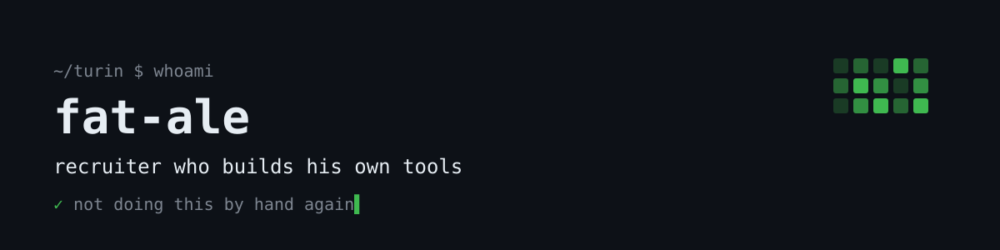

# Hi, I'm Alessandro

Recruiter in Turin. I hire tech people, and somewhere along the way I stopped waiting for tools and started building them.

Nothing here was planned as a product. Every repo started the same way: *I'm not doing this by hand again.* Then it worked, so I cleaned it up and put it here.

**Recent searches:** Forward Deployed Engineer · Solution Architect · Data Engineer · Rust / distributed systems Developer · Head of Design · Technical Lead · IT Systems Engineer

## What's here

| Project | What it does | What it replaces |
|---|---|---|
| [**Unseated**](https://github.com/fat-ale/unseated) | Outbound sourcing from a job description: search, ranked shortlist, outreach in your voice, with a human approval gate before anyone gets contacted | A LinkedIn Recruiter seat |

## How I build

- **A human decides.** Tools do the scrolling and the first screening; people decide who gets contacted.
- **Built with Claude, tested on real searches.** Every rule in these repos broke something first.
- **Honest about the limits.** Each README says what you give up, not just what you get.

## Find me

Turin, Italy
